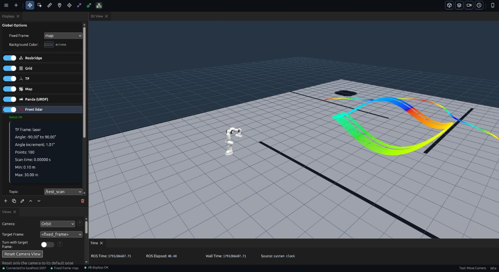

#  Vizanti - Web Visualizer & Mission Planner for ROS

[](https://opensource.org/licenses/BSD-3-Clause) [](https://build.ros2.org/job/Hdev__vizanti__ubuntu_jammy_amd64/)

Vizanti is a web-based visualization and control tool developed for more convenient operation of outdoor robots running the Robot Operating System (ROS). It shows the robot in 3D (URDF, point clouds, maps, markers, cameras and more) in an RViz-style desktop interface, and keeps a smartphone friendly touch interface; both share the same displays. The second goal is to allow planning and executing movement and mission commands, i.e. goals and waypoints, with custom buttons and parameter reconfigure.



See [docs/ui.md](docs/ui.md) for the interfaces and every display. 

## Installation

This branch is compatible with:
- [ROS 2 Humble](https://docs.ros.org/en/humble/Installation.html) on 22.04 
- [ROS 2 Jazzy](https://docs.ros.org/en/jazzy/Installation.html) on 24.04
- [ROS 2 Lyrical](https://docs.ros.org/en/lyrical/Installation.html) on 26.04

For ROS 1 [see here](https://github.com/MoffKalast/vizanti/tree/ros1).

As a field tool, Vizanti is designed to operate just as well without internet access, and as such the intended way is to host it on a robot, with rosbridge autoconnecting to the host IP.

```bash
cd ~/colcon_ws/src
git clone -b ros2 https://github.com/MoffKalast/vizanti.git

cd ..
rosdep install -i --from-path src/vizanti -y
colcon build
```

### Debian packages

To build installable `ros-<distro>-vizanti-*` .deb packages instead, run `packaging/build_debs.sh` (this machine's ROS) or `packaging/build_debs_docker.sh jazzy` (any distro, in Docker); see [docs/packaging.md](docs/packaging.md).

### Docker

Alternatively, you can also containerize Vizanti. For that you need to [install Docker](https://docs.docker.com/engine/install/ubuntu/) and build the container:

In case you're building on a system with a different version of ROS or it's not installed, replace `$ROS_DISTRO` with either humble or jazzy.

```bash
git clone -b ros2 https://github.com/MoffKalast/vizanti.git
cd vizanti
docker build -f docker/Dockerfile -t vizanti:2.0 . --build-arg ROS_VERSION=$ROS_DISTRO
```

## Run
```bash
ros2 launch vizanti_server vizanti_server.launch.py
```  
Or with Docker (set env vars directly if they need to be different):
```bash
docker run --rm -it --net=host --name vizanti-ros2 -e ROS_DOMAIN_ID=$ROS_DOMAIN_ID -e RMW_IMPLEMENTATION=$RMW_IMPLEMENTATION -e USE_RWS=false -v /dev/shm:/dev/shm vizanti:2.0
```  

The web app can be accessed at `http://<host_ip>:5000`. Client settings are automatically saved in localStorage. The satelite imagery renderer also uses the indexedDB to store tiles for offline use (note that this is IP specific). By default the rosbridge instance also occupies port 5001.

If you're using a mobile device connected to a robot's hotspot that doesn't have internet access and can't load the page, turn off mobile data. This will prevent the browser from sending packets to the wrong gateway.

####  Check [the wiki](https://moffkalast.github.io/vizanti_docs) for usage and configuration instructions, as well as feature and compatibility info.

### Zenoh (rmw_zenoh)

Vizanti works on `rmw_zenoh_cpp` with its default backend, rosbridge. As with any Zenoh setup, start the router first (`ros2 run rmw_zenoh_cpp rmw_zenohd`) and export `RMW_IMPLEMENTATION=rmw_zenoh_cpp` for Vizanti and the robot alike. The RWS backend below does not work on Zenoh.

Checked on Lyrical (rmw_zenoh_cpp 0.10.6) on 2026-11-03, with Vizanti and the robot nodes in one Zenoh graph:
- The browser test suite passes.
- The topic list shows its types, and parameters and Vizanti's services work.
- A late page subscriber gets latched topics (an OccupancyGrid).
- Static transforms come from several `/tf_static` publishers, including one started after Vizanti. Every fresh page load had all of them.
- Large messages arrive at full rate: a 1.6 MB PointCloud2 at 5 Hz and a 0.9 MB Image at 10 Hz.
- Publishing from the browser works.
- Actions work: send, feedback, result and cancel (MoveIt's `/move_action`).

## Recommended - RWS Backend

With rosbridge being a Tornado python based package and rclpy being overly CPU heavy, this cpp drop-in replacement server should result in a ~5x lower overhead and faster response times. It works with CycloneDDS out of the box, for FastDDS it requires the `rmw_fastrtps_dynamic_cpp` version which includes interface introspection. Zenoh does not support topic introspection at all, so it's not supported at the moment.

```bash
cd ~/colcon_ws/src
git clone -b $ROS_DISTRO https://github.com/v-kiniv/rws.git

cd ..
rosdep install -i --from-path src/rws -y 
colcon build
```

If using FastDDS:

```bash
sudo apt install ros-$ROS_DISTRO-rmw-fastrtps-dynamic-cpp
export RMW_IMPLEMENTATION=rmw_fastrtps_dynamic_cpp
```

Then run the RWS launch instead:

```bash
ros2 launch vizanti_server vizanti_rws.launch.py
```

Or with Docker (set env vars directly if they need to be different):
```bash
docker run --rm -it --net=host --name vizanti-ros2 -e ROS_DOMAIN_ID=$ROS_DOMAIN_ID -e RMW_IMPLEMENTATION=$RMW_IMPLEMENTATION -e USE_RWS=true -v /dev/shm:/dev/shm vizanti:2.0
```

----

## Contributing

Please see [Contributing.md](Contributing.md) for more information.

## Authors and maintainers

- Vizanti was created by Vid Rijavec ([MoffKalast](https://github.com/MoffKalast)), vid.rijavec@gmail.com, with Alastair Bradford as co-maintainer.
- The RViz-style 3D interface, the plugin system, Nav2 support and the Debian packaging are by Bruk Gebregziabher (Signalbotics), bruk@signalbotics.com, who also maintains the packages.
